<div align="center">

<picture>
  <source media="(prefers-color-scheme: dark)" srcset="docs/readme/hero-dark.svg">
  
</picture>

<br>

**Autonomous multi-agent negotiation for crisis power allocation**<br>
Build Beyond '26 · Problem Statement 1.1 · Team ScaredToCompile

<br>


<br>

[Demo](#-demo-video) ·
[The idea](#-the-idea-in-30-seconds) ·
[Agents](#-meet-the-four-agents) ·
[Dashboard](#-the-dashboard) ·
[How it works](#-how-one-minute-works) ·
[Results](#-results) ·
[Run it](#-run-it-yourself) ·
[API](#-api-reference) ·
[Repo map](#-repo-map) ·
[FAQ](#-faq)

</div>

## 🎬 Demo video

https://github.com/user-attachments/assets/a608566b-0f49-4953-8274-01412c1d31df

**Live app:** https://blackout-arena-s8pe.onrender.com <sub>(free tier: the first load can take ~50 s while it wakes up)</sub>

<picture><source media="(prefers-color-scheme: dark)" srcset="docs/readme/divider-dark.svg"></picture>

## ⚡ The idea in 30 seconds

A storm hits a city. The power grid can usually give **100 MW**, but now it swings up and down, and sometimes it suddenly loses 30 MW.

Four utilities depend on that power:

| | Utility | Normally needs | What happens when it is cut |
|---|---|---|---|
| 🏥 | **Hospital** | 38 MW | Fine for a small cut. Past about 25% short, the ICU fails fast. |
| 💧 | **Water** | 24 MW | Its reservoir covers the gap for a while. When the reservoir runs low, pressure drops. |
| 📡 | **Telecom** | 14 MW | Its batteries cover the gap. When they run out, phones go dark. |
| 🚑 | **Emergency** | 16 MW | Every missing megawatt hurts a little, steadily. |

Together they need **92 MW**. When the grid has less than that, someone has to take less.

**Blackout Arena** gives each utility its own **AI agent**. Every simulated minute the agents **bid, bargain and trade** for power. Nobody tells them who should win. A simple market and a strict ledger make sure the result is always safe: **the grid is never overloaded, not even once**.

You watch the whole thing live on a dashboard, you can **hit the city with your own disasters**, and you can compare our agents against three simple strategies on **exactly the same disaster**.

> [!NOTE]
> **How we keep it honest:** every number in this README comes from running the code in this repo. Where a simpler strategy matches or beats ours, we say so.

<picture><source media="(prefers-color-scheme: dark)" srcset="docs/readme/divider-dark.svg"></picture>

## 🤝 Meet the four agents

<picture>
  <source media="(prefers-color-scheme: dark)" srcset="docs/readme/agents-dark.svg">
  
</picture>

The tiles above show real engine output for seed 0. At **01:00** everyone is fully served. At **02:10** a substation fault has cut supply to 66 MW, and the agents have worked out a sacrifice: **Water drops to 0 MW and lives off its reservoir**, so the Hospital keeps its ICU running.

Each agent knows only **its own** needs and state. It has a **damage function**: a rule for how much harm a power cut does to it. It uses that rule to decide how much power is worth to it at any price.

| Agent | Normal need | Max draw | Weight | Critical floor | Private state | Damage shape |
|---|---:|---:|---:|---:|---|---|
| Hospital | 38 MW | 46 MW | ×10 | 60% | cooling load | **Cliff**: near zero until 25% short, then steep |
| Emergency | 16 MW | 20 MW | ×5 | 50% | effectiveness | **Straight line**: every MW counts |
| Telecom | 14 MW | 17 MW | ×3 | 30% | battery (0–1) | Tiny while the battery lasts, **sharp jump** when it is empty |
| Water | 24 MW | 29 MW | ×2 | 20% | reservoir (0–1) | Zero while the reservoir is above 50%, then **ramps up** |

**Weight** says how much each utility's damage counts towards the city total. **Critical floor** is the share of need that the safety fallback always tries to protect.

<picture>
  <source media="(prefers-color-scheme: dark)" srcset="docs/readme/damage-dark.svg">
  
</picture>

<details>
<summary><b>How exactly does each agent score damage?</b> (click to open)</summary>

<br>

Let **u** be the deficit for one minute: `u = 1 − served / need`, from 0 (fully served) to 1 (nothing).

- **Hospital:** a sigmoid "cliff" centred at 25% deficit with steepness 20, rescaled to run from 0 to 1. A small cut costs almost nothing. A big one costs almost everything.
- **Water:** the reservoir `L` drains by `0.04 × u` each minute it is short, and refills by `0.02` when it is fully served. Damage is 0 while `L ≥ 0.5`. Below that it ramps: `(0.5 − L) / 0.5 × max(u, 0.3)`.
- **Telecom:** the battery `B` drains by `0.03` each minute it is short and recharges by `0.02` otherwise. While `B > 0` damage is just `0.05 × u`. When `B = 0` it becomes `min(1, 0.05u + 1.0u)`.
- **Emergency:** `damage = u`, a straight line.

**Looking ahead:** when Water and Telecom bid, they look **15 minutes ahead** ("if I stay this short, where will my reservoir or battery be?"). The **score** uses the same damage rules for every strategy, so the comparison is fair.

All of these numbers live in [`config/damage.yaml`](config/damage.yaml) and can be changed.

</details>

### Cascades: when one failure causes another

<picture>
  <source media="(prefers-color-scheme: dark)" srcset="docs/readme/cascades-dark.svg">
  
</picture>

- **A:** water reservoir below 20% → **hospital need × 1.2** (cooling load)
- **B:** telecom battery empty → **emergency damage × 1.5** (crews lose coordination)

On seed 0 our strategy triggers cascade A at 01:54, 04:24 and 06:33, and cascade B at 05:06.

<picture><source media="(prefers-color-scheme: dark)" srcset="docs/readme/divider-dark.svg"></picture>

## 📺 The dashboard

<picture>
  <source media="(prefers-color-scheme: dark)" srcset="docs/readme/shots/live_dark.png">
  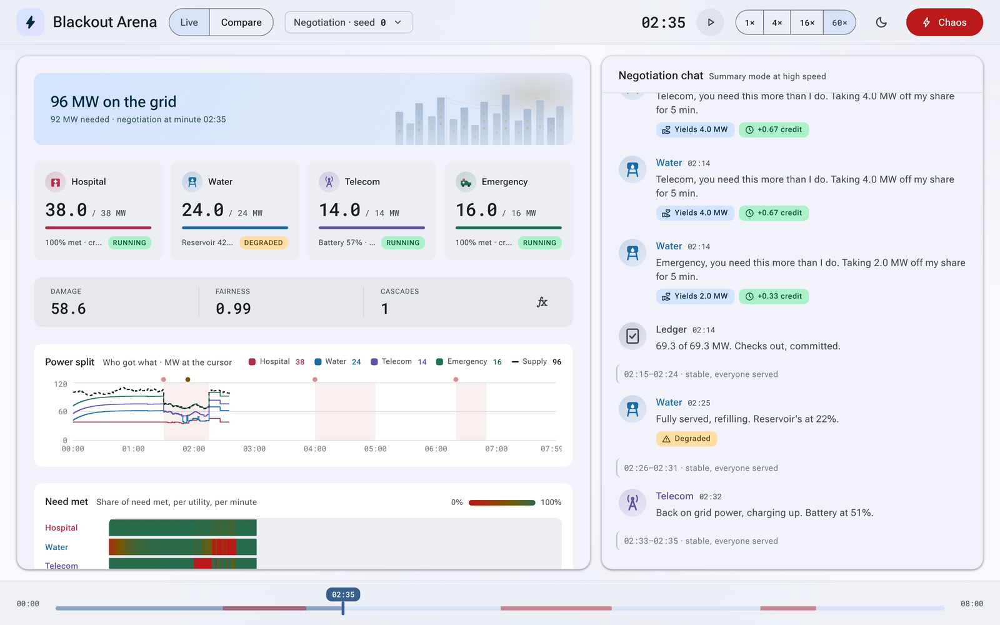
</picture>

<sub>Live view, seed 0. The dashboard follows your system theme and has a light/dark toggle. It is built on Material Design 3: tonal colours, Roboto Flex for text, Roboto Mono for every number.</sub>

**A quick tour:**

| Area | What it does |
|---|---|
| **Top bar** | Switch between **Live** and **Compare**, pick strategy and seed, see the simulation clock, pause, set speed (1×, 4×, 16×, 60×), toggle theme, and open **Chaos**. |
| **Hero card** | How many MW are on the grid right now and how many are needed. The skyline's lit windows follow how much need is being met. |
| **Agent tiles** | Each utility's MW, a progress meter, reservoir or battery level, credit, and a status badge (Running / Degraded / Down). |
| **KPI strip** | Damage so far, fairness (Jain's index) and cascades. The **ƒx** button explains exactly how each number is computed. |
| **Charts** | Four synced charts: power split, a need-met heatmap, damage per minute, and buffers + price. Hover for details, click to pin a minute. |
| **Negotiation chat** | The agents talk, but only when something changes: a shock, a cascade, a deal, a buffer running low. Quiet minutes fold into one line. Click a message to jump the charts to that minute. |
| **Timeline** | Scrub through all 8 hours. Red bands are scripted shocks. Orange ticks are chaos you injected. |

<table>
<tr>
<td width="62%" valign="top">

**Compare view:** all four strategies on the same seed, with the winner of each metric marked **best**. The [results](#-results) section below shows the same numbers over 20 seeds.

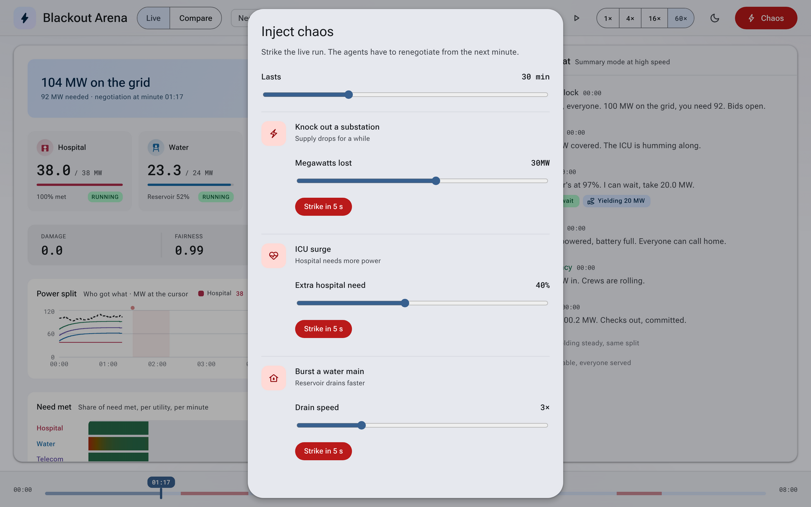

**Inject chaos** during a live run:
- **Knock out a substation:** supply drops by X MW
- **ICU surge:** hospital need goes up by Y%
- **Burst a water main:** the reservoir drains up to 3× faster

The agents renegotiate from the next minute.

</td>
<td width="38%" valign="top">

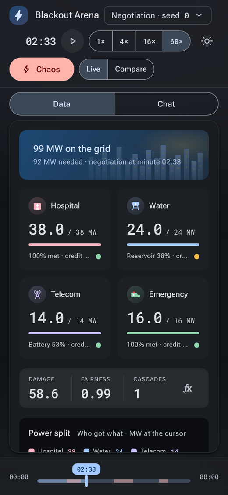

**Works on a phone.** Data and Chat become two tabs.

</td>
</tr>
</table>

<picture><source media="(prefers-color-scheme: dark)" srcset="docs/readme/divider-dark.svg"></picture>

## 🔁 How one minute works

<picture>
  <source media="(prefers-color-scheme: dark)" srcset="docs/readme/flow-dark.svg">
  
</picture>

The core rule: **agents decide; the infrastructure only publishes, checks and records.** The market clock never hands out power. The ledger never picks a winner.

### Step 1 · Supply

The grid's supply is a **seeded random walk** around 100 MW (it drifts, stays between 60 and 110), plus **scripted shocks** from the scenario file, plus any **chaos** you inject. Same seed means the same disaster, byte for byte.

### Step 2 · Layer 1: price discovery

<picture>
  <source media="(prefers-color-scheme: dark)" srcset="docs/readme/layer1-dark.svg">
  
</picture>

Think of an auctioneer who only shouts prices.

1. The **market clock** announces a price `p`. It starts from last minute's price.
2. Every agent answers: *"At this price, I want q MW."* It works that out from its own damage function. An agent keeps asking for more power only while one more MW saves it at least `p` worth of damage.
3. The clock adds up the demand `D` and compares it with supply `S`:
   - too much demand → the price goes up
   - too little → the price goes down
   - `p ← p × (1 + 0.5 × (D − S) / S)`, damped so it doesn't overshoot
4. It stops when demand is within **0.5 MW** of supply, or after **8 rounds**. Then a quick **bisection** finds the lowest price at which every bid fits.

<details>
<summary><b>The same trace as a table</b> (seed 0, minute 06:50)</summary>

<br>

The "cascading grid trip" has just ended and supply is back to 99.9 MW. Watch the price fall and the agents come back in:

| Round | Price | Hospital | Water | Telecom | Emergency | Total demand |
|---:|---:|---:|---:|---:|---:|---:|
| 1 | 0.313 | 39.75 | 24.0 | 0 | 0 | 63.75 |
| 2 | 0.279 | 40.25 | 24.0 | 0 | **16.0** | 80.25 |
| 6 | 0.219 | 40.75 | 24.0 | **14.0** | 16.0 | 94.75 |
| 8 | 0.213 | 41.0 | 24.0 | 14.0 | 16.0 | 95.0 |
| clearing | 0.010 | 45.6 | 24.0 | 14.0 | 16.0 | **99.6 ≤ 99.9 ✓** |

(The hospital's need is 45.6 here because cascade A is active: 38 × 1.2.)

</details>

### Step 3 · Layer 2: one-to-one deals

The price is a blunt tool, so after it settles the agents **bargain in pairs** (up to 3 rounds).

An agent that can spare power for a moment (say Water, whose reservoir is full) offers it to an agent that badly needs it:

<picture>
  <source media="(prefers-color-scheme: dark)" srcset="docs/readme/layer2-dark.svg">
  
</picture>

That is a real deal from seed 0. The pair with the biggest net gain is offered first. The receiver can **accept**, **counter** (with half the MW) or **reject**. Total power never changes, only who holds it.

### Step 4 · Credit, so helping out pays off

The agent that gives power banks **credit**: `x MW × 5 min / 30`, capped at 1.0. Credit **raises that agent's bidding weight later**:

```
effective weight = weight × (1 + 0.5 × credit)      credit decays 2% per minute
```

The receiver's credit goes negative (it owes). Debts are tracked and shown, but **they never lower an agent's bid**. An early version let debt starve the hospital, and damage went up 60%, so we switched that off.

### Step 5 · The ledger: propose → validate → commit

The final split goes to the ledger, which checks it against every safety rule (below). If it passes, the whole split is committed **at once, for all four agents or none**.

### Step 6 · The fallback, which never deadlocks

If the negotiation doesn't settle, or the ledger rejects it, a **deterministic fallback** takes over: every agent first gets its critical floor, then the rest is shared by weight ("water-filling"). If even the floors don't fit, they are filled in priority order. No randomness, no negotiation, always feasible.

> [!TIP]
> In 1000 fuzzed runs the fallback **never had to fire**. The negotiation always settled. It is still tested on its own with property-based tests.

### Fairness: Jain's index

For each agent we take the average share of its need that was met, `sᵢ`, over the run. Then:

```
J = (Σ sᵢ)² / (n × Σ sᵢ²)        n = 4
```

**1.0** means everyone got the same share of what they needed. Lower means some agents were squeezed harder than others. It is "priority-blind": it treats the hospital and the water plant the same, which is why we report it next to damage and don't use it alone.

<picture><source media="(prefers-color-scheme: dark)" srcset="docs/readme/divider-dark.svg"></picture>

## 🌪 The disaster

The default scenario, [`scenarios/default_8h.yaml`](scenarios/default_8h.yaml), runs **480 minutes** (8 hours, one tick per minute):

<picture>
  <source media="(prefers-color-scheme: dark)" srcset="docs/readme/timeline-dark.svg">
  
</picture>

- **01:30 → 02:15** Substation fault, −30 MW
- **04:00 → 05:00** Storm line damage, −25 MW
- **06:20 → 06:50** Cascading grid trip, −35 MW
- **All day:** a random walk (σ = 1.5 MW, kept between 60 and 110 MW), plus any **chaos** you inject

### The three strategies we compete against

Same seed, same damage rules, same independent safety checker:

| Strategy | How it works | Weak spot |
|---|---|---|
| **Blind grab** | Everyone takes its full need. If that's more than supply, the grid **trips**: −20% supply for 5 minutes. | Breaks the safety rules constantly. |
| **Proportional** | Everyone gets the same percentage cut. | Fair on paper, but it cuts the hospital as much as the water plant. |
| **Static priority** | Hospital first, then Emergency, Telecom, Water. | Ignores buffers: Water gets starved even when its reservoir could have helped. |

<picture><source media="(prefers-color-scheme: dark)" srcset="docs/readme/divider-dark.svg"></picture>

## 🔒 Safety rules that never break

An **independent checker** ([`invariants.py`](engine/blackout_arena/invariants.py)) watches every minute of every run, ours and the baselines alike:

<picture>
  <source media="(prefers-color-scheme: dark)" srcset="docs/readme/safety-dark.svg">
  
</picture>

**Result:** 0 violations for our strategy across **1000 fuzzed runs** with random supply walks and shocks (`scripts/fuzz.py`, plus hypothesis property tests).

<picture><source media="(prefers-color-scheme: dark)" srcset="docs/readme/divider-dark.svg"></picture>

## 📊 Results

<picture>
  <source media="(prefers-color-scheme: dark)" srcset="docs/readme/results-dark.svg">
  
</picture>

20 seeds, the same seeded disaster for every strategy. Damage is a **modeled proxy**, not a real-world measurement.

| Strategy | Damage (mean ± std) | Violations | Jain | Cascades |
|---|---:|---:|---:|---:|
| **Ours** (Layer 1 + Layer 2 + credit) | **179.7 ± 46.4** | **0** | 0.991 | 4.10 |
| Static priority | 194.0 ± 58.6 | 0 | 0.984 | 3.45 |
| Proportional | 787.2 ± 153.0 | 0 | **1.000** | **2.80** |
| Blind grab | 3368.1 ± 281.4 | 413.9 | 1.000 | 415.85 |
| *Ablation:* ours without Layer 2 | 190.9 ± 70.6 | 0 | 0.990 | 2.65 |
| *Ablation:* ours without credit | 178.8 ± 47.7 | 0 | 0.991 | 4.20 |

### What this really says

- ✅ **19× less damage than blind grab** and it never breaks a safety rule (blind grab breaks one about 414 times a run).
- ✅ **4.4× less damage than proportional.**
- ⚖️ **Against static priority it's close.** We have lower damage on 11 of 20 seeds (mean −14.4), but that is inside one standard deviation, so call it a tie that leans our way. We are fairer (0.991 vs 0.984).
- 🧩 **Layer 2 lowers damage about 6%**, but it also **raises cascades** (4.10 vs 2.65). It likely spends buffers for short-term gains. That's our next thing to fix.
- 🤷 **Credit made no measurable difference** to damage or fairness in this scenario. We present it as a fairness mechanism that costs nothing, not as a proven improvement.
- 📏 **Proportional has perfect fairness (1.000)**, because cutting everyone equally is fair by definition. It's also 4× more damaging.

<sub>Reproduce: `python scripts/run_benchmark.py --seeds 20 --ablations && python scripts/export_report.py` → [`docs/RESULTS.md`](docs/RESULTS.md)</sub>

<picture><source media="(prefers-color-scheme: dark)" srcset="docs/readme/divider-dark.svg"></picture>

## 🧱 Architecture

<picture>
  <source media="(prefers-color-scheme: dark)" srcset="docs/readme/arch-dark.svg">
  
</picture>

**Three things that make it trustworthy:**

1. **Deterministic.** Seeded `numpy` PCG64 RNG, no wall clock, no global randomness. Same seed and config give a **byte-identical event log**, and that's tested.
2. **Everything is an event.** Every bid, offer, commit and cascade is appended to one log. The dashboard, the replay scrubber and the chat are all built from it.
3. **No LLM touches a decision.** The plain-English `EXPLANATION` lines come from fixed templates, written **after** the commit, and agents never read them.

<details>
<summary><b>Event types</b></summary>

<br>

Every event looks like `{ "seq": int, "tick": int, "t": "HH:MM", "type": str, "agent": str|null, "payload": {...} }`.

`SUPPLY_UPDATE` · `CHAOS_INJECTED` · `PRICE_BROADCAST` · `BID` · `OFFER` · `COUNTER` · `CONCESSION` · `CREDIT_UPDATE` · `PROPOSE` · `VALIDATED` · `REJECTED` · `COMMIT` · `FALLBACK` · `DAMAGE_TICK` · `CASCADE_TRIGGERED` · `TICK_SUMMARY` · `EXPLANATION`

`TICK_SUMMARY.payload` carries: supply, grants per agent, served % per agent, damage this tick and cumulative, reservoir, battery, price, rounds used, and whether the fallback was used.

</details>

<picture><source media="(prefers-color-scheme: dark)" srcset="docs/readme/divider-dark.svg"></picture>

## 🚀 Run it yourself

<picture>
  <source media="(prefers-color-scheme: dark)" srcset="docs/readme/terminal-dark.svg">
  
</picture>

**You need:** Python 3.11+ and Node.js 18+.

**1. Get the code**

```bash
git clone https://github.com/priyanshusharan-cmd/build-beyond-2026.git
cd build-beyond-2026
```

**2. Install Python packages** (a virtual environment is recommended)

```bash
python -m venv .venv
# Windows:        .venv\Scripts\activate
# macOS / Linux:  source .venv/bin/activate
pip install pydantic numpy pyyaml fastapi "uvicorn[standard]" httpx pytest hypothesis
```

**3. Install the dashboard**

```bash
npm --prefix web install
```

**4. Start both halves, in two terminals from the repo root**

```bash
python -m uvicorn api.app:app --port 8010     # terminal 1: the API
npm --prefix web run dev                      # terminal 2: the dashboard
```

**5. Open http://localhost:5173.** A run of our strategy on seed 0 starts by itself. Try 60× speed, then hit **Chaos**.

> [!TIP]
> Port 8010 taken? Run the API on another port and tell Vite:
> `API_PORT=8011 npm --prefix web run dev` (PowerShell: `$env:API_PORT=8011; npm --prefix web run dev`)

### Command-line tools

| Command | What it does |
|---|---|
| `python -m pytest -q` | All tests: determinism, ledger, invariants, agents, market, Layer 2, fuzzing, API |
| `python scripts/run_one.py --strategy ours --seed 0` | One run with a readable timeline; JSONL log saved to `results/` |
| `python scripts/run_benchmark.py --seeds 20` | Mean ± std for every strategy; writes `results.json` and CSV |
| `python scripts/run_benchmark.py --seeds 20 --ablations` | Adds the "no Layer 2" and "no credit" ablations |
| `python scripts/export_report.py` | Turns `results.json` into `docs/RESULTS.md` |
| `python scripts/fuzz.py --runs 1000` | Random supply walks and shocks; expects 0 violations |

Strategies: `ours`, `blind`, `proportional`, `priority`, `ours_no_l2`, `ours_no_credit`.

<picture><source media="(prefers-color-scheme: dark)" srcset="docs/readme/divider-dark.svg"></picture>

## 🔌 API reference

| Method | Path | Purpose |
|---|---|---|
| `GET` | `/health` | Health check |
| `GET` | `/scenarios` | Available scenarios |
| `POST` | `/runs` | Start a run `{scenario, seed, strategy, speed}` → `{run_id, ...}` |
| `GET` | `/runs/{id}` | Run info, current snapshot, metrics when done |
| `GET` | `/runs/{id}/events?from=seq` | Replay events from a sequence number |
| `WS` | `/runs/{id}/stream` | Live frames `{events, snapshot, done, metrics?}` |
| `POST` | `/runs/{id}/chaos` | `{kind: kill_substation \| icu_surge \| burst_main, params}` |
| `POST` | `/runs/{id}/control` | `{speed?, paused?}` |
| `GET` | `/compare?seed=` | Metrics and time series for all four strategies on one seed |

<details>
<summary><b>Example: start a run and strike it</b></summary>

```bash
curl -X POST localhost:8010/runs -H "Content-Type: application/json" \
     -d '{"scenario":"default_8h","seed":0,"strategy":"ours","speed":16}'
# → {"run_id": "...", ...}

curl -X POST localhost:8010/runs/<run_id>/chaos -H "Content-Type: application/json" \
     -d '{"kind":"kill_substation","params":{"mw":30,"duration":30}}'
```

</details>

<picture><source media="(prefers-color-scheme: dark)" srcset="docs/readme/divider-dark.svg"></picture>

## 🔧 Configuration

Change the world without touching code:

<details>
<summary><b><code>config/damage.yaml</code>: the damage model and negotiation settings</b></summary>

<br>

| Section | Key settings |
|---|---|
| `weights` | hospital 10, emergency 5, telecom 3, water 2 |
| `critical_floor_frac` | hospital 0.6, emergency 0.5, telecom 0.3, water 0.2 |
| `priority_order` | used by the static-priority baseline and by the fallback when floors don't fit |
| `hospital` | `cliff_center` 0.25, `cliff_steepness` 20, `cooling_need_mult` 1.2 |
| `water` | reservoir starts full, `drain_rate` 0.04, `refill_rate` 0.02, damage below 0.5, low pressure below 0.2 |
| `telecom` | battery starts full, `drain_rate` 0.03, `recharge_rate` 0.02, `down_damage_mult` 4 |
| `emergency` | `linear_slope` 1.0, `effectiveness_loss_mult` 1.5 |
| `fairness` | `lambda_credit` 0.5, `credit_decay` 0.02 |
| `layer2` | 3 rounds, chunks of 0.5 / 1 / 2 / 4 MW, 5-minute deals, `min_gain` 0.05, credit scale 30, debt floor −1, cap 1, `debt_penalizes: false` |
| `market` | `p0` 1.0, `eta` 0.5, `damping` 0.6, `eps` 0.5 MW, 8 rounds, `p_min` 0.01 |

If you change this file, keep `web/src/components/Method.jsx` (the "How these numbers are computed" dialog) in sync.

</details>

<details>
<summary><b><code>scenarios/*.yaml</code>: write your own disaster</b></summary>

```yaml
name: my_storm
ticks: 480                 # minutes
nominal_supply: 100.0
needs:    { hospital: 38, water: 24, telecom: 14, emergency: 16 }
max_draw: { hospital: 46, water: 29, telecom: 17, emergency: 20 }
supply_walk: { sigma: 1.5, min: 60, max: 110, mean_revert: 0.05 }
shocks:
  - { tick: 90, duration: 45, delta_mw: -30, label: "Substation fault" }
```

</details>

<picture><source media="(prefers-color-scheme: dark)" srcset="docs/readme/divider-dark.svg"></picture>

## 📁 Repo map

```
build-beyond-2026/
├── config/damage.yaml            damage model + negotiation parameters (editable)
├── scenarios/default_8h.yaml     the default 8-hour disaster
├── engine/blackout_arena/
│   ├── agents/                   one file per utility + system.py (bids, cascades, chaos)
│   │   ├── hospital.py · water.py · telecom.py · emergency.py · base.py
│   ├── market.py                 market clock: price discovery, never allocates
│   ├── sim.py                    the minute loop: Layer 1, Layer 2, credit, explanations
│   ├── ledger.py                 propose → validate → commit, and the fallback split
│   ├── invariants.py             independent checker for INV-1 … INV-5
│   ├── baselines.py              blind grab, proportional, static priority, ablations
│   ├── fairness.py               Jain's index, credit weight and decay
│   ├── metrics.py                per-run metrics, comparisons, multi-seed aggregates
│   ├── events.py · models.py     event log (JSONL) and data contracts
│   └── config.py                 loads and validates the YAML files
├── api/app.py                    FastAPI: runs, WebSocket stream, chaos, control, compare
├── web/src/
│   ├── App.jsx                   app bar, Live / Compare views, timeline
│   ├── components/               Charts, Chat, CompareView, Sheets (dialogs), Method,
│   │                             Avatars, Illustrations
│   ├── story.js                  turns events into the negotiation chat
│   ├── useRun.js · useTheme.js   live run state, light/dark theme
│   └── styles.css                the Material 3 token system
├── tests/                        pytest + hypothesis
├── scripts/                      run_one, run_benchmark, export_report, fuzz
└── docs/
    ├── RESULTS.md                latest benchmark report (generated)
    ├── STATUS.md                 done / in progress / next
    ├── report/                   Review 2 report (PDF + HTML)
    └── readme/                   the graphics and screenshots in this README
```

<picture><source media="(prefers-color-scheme: dark)" srcset="docs/readme/divider-dark.svg"></picture>

## ❓ FAQ

<details>
<summary><b>Is this real power-grid data?</b></summary>
<br>
No. It is a simulation with a <b>modeled</b> damage score. The numbers compare strategies against each other on the same disaster. They are not real-world casualty or outage figures.
</details>

<details>
<summary><b>Where is the AI if there's no LLM?</b></summary>
<br>
The agents are autonomous decision-makers: each one has private goals and state, works out its own bids, and decides on its own whether to offer, accept, counter or reject a deal. That is multi-agent AI in the classic sense. We kept LLMs out of the decisions on purpose, so every result can be reproduced exactly and checked.
</details>

<details>
<summary><b>Can the agents cheat and overload the grid?</b></summary>
<br>
No. Agents only <i>ask</i>. The ledger checks every proposal against the safety rules before anything is committed, and an independent checker re-verifies every minute. Our strategy has 0 violations across 1000 fuzzed runs.
</details>

<details>
<summary><b>Why does static priority come so close?</b></summary>
<br>
In this scenario the hospital matters most by a wide margin, and "hospital first" is already a strong rule. Our agents win on more seeds and are fairer because they use the water reservoir and telecom batteries as buffers, but the gap is within noise. We report it as it is.
</details>

<details>
<summary><b>What would you build next?</b></summary>
<br>
Make Layer 2 aware of the cascades it causes (it currently raises them), add the ablations to the Compare view, and add more agents and scenarios.
</details>

<br>

<picture>
  <source media="(prefers-color-scheme: dark)" srcset="docs/readme/footer-dark.svg">
  
</picture>
